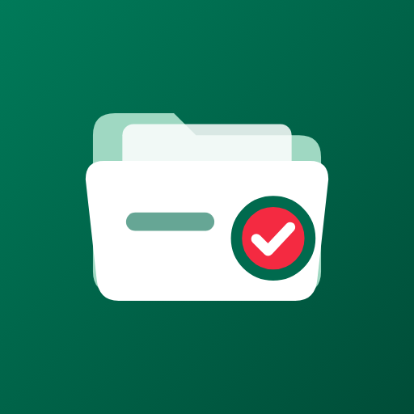

<p align="center">
  
</p>

<h1 align="center">সেনানথি (Shenanothi)</h1>

<p align="center"><b>Your personal service file, on your phone.</b><br>
Every service document in one place: DivOs, CORO, BAO, posting orders, course reports, exam results, certificates, tax papers and BAFZ 2043.</p>

<p align="center"><a href="https://mahmud629.github.io/Shena-nothi/"><b>Open the app →</b></a></p>

---

## What it does

সেনানথি keeps an officer's service documents organised, scanned and easy to find. It shows at a glance what is stored, what is missing and what still needs a scan.

All data stays in a **hidden folder in the user's own Google Drive**. There is no server and no shared database. Nobody else can see a user's documents, including the developer.

## Features

| Feature | What it does |
|---|---|
| **Login with Gmail** | One tap. No new password. |
| **Home dashboard** | Completeness ring with counts of stored, missing and unscanned documents, plus the BAFZ 2043 progress. |
| **Twelve sections** | Personal documents, Civil education, IPFT DivO, RET DivO, Courses, Exam results, CORO, BAO, Posting orders, Awards and punishments, Tax, Other documents. Each has its own **+ Add** button. |
| **Scan upload** | Attach a photo or PDF to any entry. It is renamed automatically (`YYYY-MM-DD_Section_Title.pdf`) and saved to Drive. |
| **Entered without a scan** | Lists entries still missing a scan, with an **Add scan** button for each. |
| **Open scan** | View any scan full screen, or download it. |
| **Documents menu and search** | Pick a section from the side menu, or search by title, reference or remarks. |
| **IPFT and RET tracker** | Year-by-year grid. IPFT 1 (Jan–Jun) and IPFT 2 (Jul–Dec) show **Pending** inside their window and **Missing** after it. |
| **BAFZ 2043** | The full particulars and record of service form, in sub-sections. Empty fields are shaded red. **Save**, and **Download as Word** (.docx) at any time. Import or export the form data as a file. |
| **Settings** | Photo and personal details, IPFT tests per year, **Export everything** (all scans, the register and BAFZ 2043 data in one zip), print the register. |
| **Day and night mode** | Switch from the header. |
| **Optional encryption** | Set a passphrase at first login and everything is encrypted (AES-256) on the device before upload. |
| **Install as an app** | Add to the home screen on iPhone or Android. Can be packaged as an Android APK. |

## How to use

1. Open **https://mahmud629.github.io/Shena-nothi/** in Chrome (Android) or Safari (iPhone).
2. Press **Login with Gmail** and choose your account.
3. Google asks once to let the app store its own data in your Drive. Press **Allow**.
4. Enter your BA no, rank, name, unit and year of commission.
5. Add documents with the **+** button on each section, attaching the scan as you go.

**Add to your home screen**
- **iPhone:** Safari → Share → *Add to Home Screen*
- **Android:** Chrome → ⋮ menu → *Add to Home screen* or *Install app*

**Try it first:** press *Look around without logging in* on the login screen to open a demo with sample data. Nothing is saved in the demo.

## Android app

Download the latest **senanothi.apk** from the [Releases page](https://github.com/Mahmud629/Shena-nothi/releases/latest) and open it on an Android phone. Allow the browser or Files app to install unknown apps if asked. The app needs Google Chrome on the phone.

The APK is a Trusted Web Activity: it opens the live web app full screen inside Chrome, so it always runs the latest version and Google sign-in works as on the web. It is built automatically by GitHub Actions; see [PUBLISHING.md](PUBLISHING.md).

## Privacy and security

- The app requests only the `drive.appdata` permission. It can read and write **its own hidden folder** and nothing else in the user's Drive.
- Documents never pass through any other server.
- With encryption on, a forgotten passphrase **cannot be recovered**, so the files would be unreadable.
- Use **Export everything** in Settings regularly and keep the backup offline.
- **Upload only documents you are permitted to keep on a personal Google account.** Do not upload classified documents. Follow your unit's IT and security instructions.

## Files in this repository

| File | Purpose |
|---|---|
| `index.html` | The whole app in one file |
| `manifest.webmanifest` | Lets the app install on a phone's home screen |
| `sw.js` | Service worker that caches the app's own files |
| `icon-512.png`, `icon-192.png`, `apple-touch-icon.png` | App icons |
| `android/` | Android app project (Trusted Web Activity) |
| `.github/workflows/build-apk.yml` | Builds the APK on GitHub and publishes it as a release |
| `user-site/` | Files for the `mahmud629.github.io` repository that let the Android app open full screen |
| `PUBLISHING.md` | Step-by-step publishing guide |

## Running your own copy

1. Fork this repository and turn on **GitHub Pages** (Settings → Pages → branch `main`, folder `/root`).
2. In Google Cloud Console:
   - Create a project and enable the **Google Drive API**.
   - Set up the **OAuth consent screen** (External) and add the scope `drive.appdata`.
   - Create an **OAuth client ID** of type *Web application*. Under **Authorised JavaScript origins** add your Pages origin only, for example `https://yourname.github.io`.
   - Press **Publish app** on the consent screen so any Gmail account can log in. In *Testing* mode only 100 listed test users can.
3. Paste the client ID into `index.html`:
   ```js
   const CONFIG = { CLIENT_ID: 'your-id.apps.googleusercontent.com' };
   ```
4. Commit, wait a minute, and open your Pages address.

## Limits and cost

- **Users:** no limit once the consent screen is published.
- **Storage:** each user's own Google Drive (15 GB free per account).
- **Cost:** free. No billing account is needed for the Drive API, and GitHub Pages is free for public repositories.

## Built with

Plain HTML, CSS and JavaScript in a single file, with no build step. Uses Google Identity Services for login, the Google Drive REST API for storage, the Web Crypto API for encryption, [docx](https://github.com/dolanmiu/docx) for the Word export and [JSZip](https://stuk.github.io/jszip/) for backups.

---

<p align="center">Prepared by: <b>BA 11108 Capt Asif Mahmud, Sigs</b></p>
